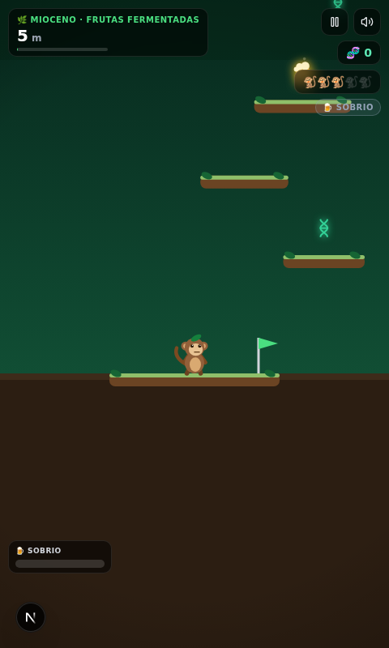
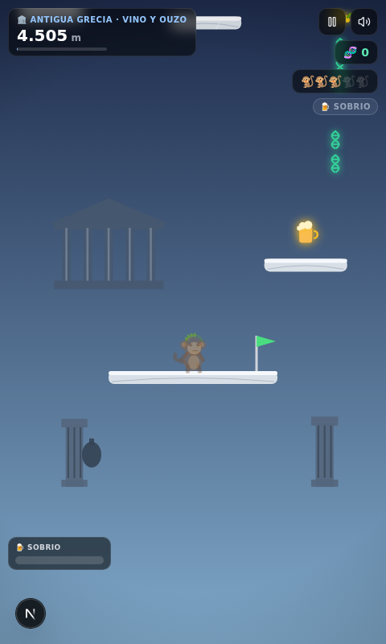
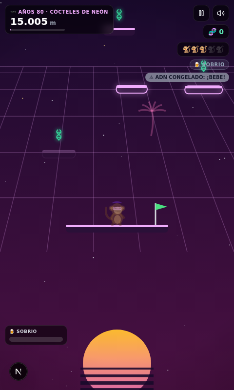
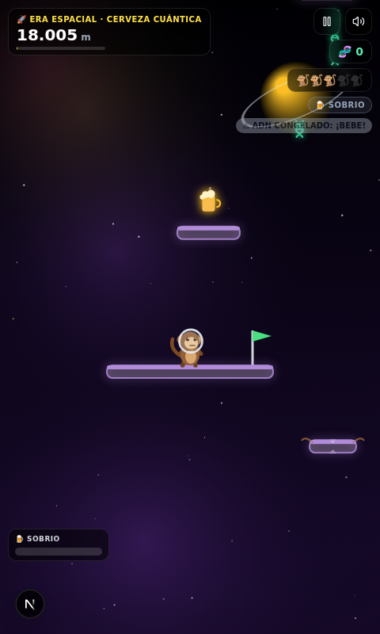

<div align="center">

# 🐒🍺 DRUNKOLUTION

### *The Drunken Ape Theory*

**Un endless jumper vertical donde la evolución humana fue impulsada por frutas fermentadas.**

Sí, la hipótesis del "mono borracho" de Robert Dudley es (casi) real. Nosotros solo la tomamos en serio. Muy en serio.


</div>

---

## 📸 Esto se ve así

| | |
|---|---|
|  |  |
|  |  |

> Las **13 capturas completas** de cada era están en [`public/capturas/`](public/capturas/).

---

## 🧬 La teoría

En 2000, el biólogo **Robert Dudley** propuso que los primates desarrollamos la atracción al etanol porque las frutas fermentadas eran una fuente de energía fiable. Es decir: **bebemos porque nuestros ancestros monos bebían.**

DRUNKOLUTION lleva esa idea 19.500 metros hacia arriba: eres un mono que escala la evolución **de pura ressaca**, saltando de plataforma en plataforma mientras bebe la bebida alcohólica insignia de cada época. Nunca te conviertes en humano — el mono siempre es un mono, solo cambia de **disfraz cultural** (con sus orejas, su hocico y su cola, por favor).

---

## 🍺 El Motor de Ebriedad (el corazón del juego)

Un sistema de 4 estados que cambia FÍSICA, PUNTUACIÓN y VISUALIZACIÓN en tiempo real:

| Estado | Nivel | Efectos |
|---|---|---|
| 🧊 **SOBRIO** | 0–30% | Control perfecto... pero si no bebes en 8s, tu **ADN deja de contar**. El estancamiento es anti-evolutivo. |
| 😄 **ALEGRE** | 31–70% | **×1.5 ADN**, saltos más altos, colores saturados. La zona dorada. |
| 🍸 **CIEGO** | 71–99% | **×2.5 ADN**, inercia brutal, **ojo de pez**, plataformas fantasma dobles, y el **HUD te miente** (los números bailan). Música desafinada con eco. |
| 🚨 **BLACKOUT** | 100% | Ragdoll fuera de control 2 segundos. Pierdes una vida. Classic. |

**Extras fermentados:**
- 🫨 **¡El Hipo!** — saltito automático random (más frecuente en modo Ciego)
- 🤕 **Minijuego de Resaca** — al cambiar de era: bebe 💧 → toma 💊 → café ☕ en orden y a tiempo, o llegas temblando a la siguiente época

---

## 🏛️ Las 13 eras

Cada era tiene sus propias plataformas, arte, música procedural y bebida:

| # | Era | Bebida | Mecánica especial |
|---|---|---|---|
| 1 | 🌿 **Mioceno** | Frutas fermentadas | Tutorial: hojas y lianas |
| 2 | 🏺 **Neolítico** | Cerveza de barro | Plataformas que se desmoronan al pisar |
| 3 | 🏜️ **Egipto Eterno** | Vino de dátiles | Plataformas móviles |
| 4 | 🏛️ **Antigua Grecia** | Vino y Ouzo | **Mármol ultra resbaladizo** (inercia filosófica) |
| 5 | 🍷 **Imperio Romano** | Vino de ánfora | Fuentes de vino = trampolines épicos |
| 6 | 🏰 **Edad Media** | Hidromiel | Púas + **cuervos que te empujan** |
| 7 | 🎨 **Renacimiento** | Vino Chianti | Ornitópteros de Da Vinci (suben/bajan) |
| 8 | 🌀 **Impresionismo** | Absenta | Plataformas que se **derriten como pintura de Van Gogh** |
| 9 | 🥃 **La Prohibición** | Moonshine | **Cajas falsas** (solo el Ciego las delata) |
| 10 | ⚙️ **Revolución Industrial** | Gin Tonic | Engranajes giratorios y humo que tapa la vista |
| 11 | 🕶️ **Años 80** | Cócteles de neón | Plataformas que parpadean al ritmo del synthwave |
| 12 | 🌃 **Cyberpunk 2099** | Neon-Vodka | Hologramas con glitch |
| 13 | 🚀 **Era Espacial** | Cerveza Cuántica | **Gravedad 0.4×** — flotación total |

---

## 👹 Los 5 Guardianes de la Sobriedad (Bosses)

| Boss | Era | Cómo vencerlo |
|---|---|---|
| 🐘 **Mamut Anti-Resaca** | Neolítico | Lánzale 3 botellas (Espacio) mientras esquiva hielo y humo medicinal |
| ⚔️ **Sir Abstinence** | Edad Media | Su "luz sagrada" **invierte tus controles** — viértele vino en la visera |
| ✈️ **Agente de la Ley Seca** | Prohibición | Corchos y redes — haz que su propio moonshine explote su dirigible |
| 🤖 **SOBER-9000** | Cyberpunk | Un AI que solo es vulnerable si estás **EBRIO** (sobrio = daño 0). Paradójico. |
| 🐒 **Dios Simio Cósmico** | Espacio | Te tira planetas. Respóndele con un eructo-láser cargado de estrellas de neutrones |

---

## 😂 Los 3 power-ups cómicos

- 📞 **El Teléfono del Ex** — te congelas en el aire 5s, invencible, hablando estupideces. Ganas una vida, pierdes altura y dignidad.
- 🥙 **El Kebab de la Sabiduría** — te sobria al 20% + escudo de grasa. **Riesgo:** si estás muy ebrio, puedes comerte una botella por error.
- 🛸 **El Plato de Tapas Volador** — orbita y destruye proyectiles. Al 5º golpe, explota en lluvia de puntos.

---

## 💰 Monetización (con humor, todo simulado)

- 🥙 **La Cura Milagrosa** — mira un anuncio y revive cayendo del cielo en un kebab volador
- 🍸 **El Bar de la Esquina** — duplica el ADN de tu partida viendo un anuncio
- 📺 **Intersticiales disfrazados** — *"La transición a Grecia es patrocinada por Agua Mineral FAKE™"*
- 👑 **Tarjeta VIP del Borracho ($2.99)** — sin anuncios forzados + monóculo + puro para tu mono

---

## 🚀 Correrlo localmente

```bash
# clona e instala
git clone https://github.com/TU-USUARIO/drunkolution.git
cd drunkolution

# con bun (recomendado, rapidísimo)
bun install
bun run dev

# o con npm
npm install
npm run dev
```

Abre [http://localhost:3000](http://localhost:3000) y a evolucionar. 🍻

### 🎮 Controles

| Acción | Teclado | Móvil |
|---|---|---|
| Moverse | `←` `→` o `A` `D` | Toca izquierda/derecha · giroscopio |
| Lanzar botella (bosses) | `Espacio` | Botón en pantalla |
| Saltas | **Automático** al tocar plataformas | — |

### 🐞 Modo desarrollador

Agrega `?dev=1` a la URL para desbloquear el panel de trucos: saltar a cualquier era, ajustar ebriedad, botellas infinitas y cura instantánea. Perfecto para probar los bosses sin escalar 19.500 m.

---

## 🏗️ Estructura

```
src/
├── app/                  # Next.js App Router
│   ├── layout.tsx
│   ├── page.tsx          # → MonosGame
│   └── globals.css
├── components/monos/
│   └── MonosGame.tsx     # UI: menú, HUD, modales, ads, VIP, resaca
├── game/
│   ├── engine.ts         # Física, Motor de Ebriedad, bosses, generación procedural
│   ├── render.ts         # Todo dibujado por código (Canvas 2D, 0 assets externos)
│   ├── eras.ts           # 13 eras, 5 bosses, estados de ebriedad, upgrades
│   ├── audio.ts          # SFX sintetizados + música procedural por era (WebAudio)
│   ├── storage.ts        # localStorage: récord, ADN, lab, estadísticas
│   └── types.ts
└── hooks/  lib/          # toast + utilidades
public/capturas/          # Screenshots de las 13 eras
```

**Cero assets externos**: todo el arte es Canvas 2D programático y todo el audio es WebAudio sintetizado. El bundle es puro código. 💪

---

## 🗺️ Roadmap

- [ ] Leaderboard online (la resaca global)
- [ ] Skins de disfraz comprables con ADN
- [ ] Modo "Fiesta Local" (2 monos, 1 teclado, cero dignidad)
- [ ] Integración real de anuncios (AdMob / Unity Ads) para móvil
- [ ] PWA para jugar offline en el bus 🚌

---

## 📜 Licencia

MIT — haz lo que quieras, pero si haces millones, invítanos una ronda. 🍺

<div align="center">

**"Evolutivamente hablando, nos gusta la bebida." — Robert Dudley (aproximadamente)**

🐒 *De un mono borracho en el Mioceno... a un simio cósmico resacoso.* 🚀

</div>
